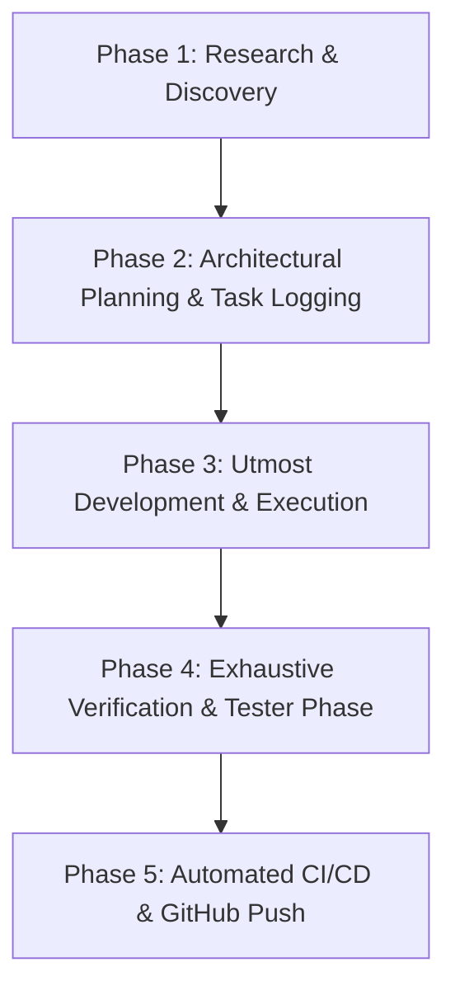

# 🚀 AGENTS.MD — MASTER DEVOPS & ENGINEERING LIFECYCLE CONTRACT

> **Mandatory Operating Protocol**: Every task, command, and feature request MUST execute through this strict 5-Phase DevOps Lifecycle. No step may be skipped, short-circuited, or treated superficially.

---

## 🏛️ THE 5-PHASE DEVOPS LIFECYCLE

---

### 🔍 PHASE 1: RESEARCH & DISCOVERY
Before writing or modifying any code:
1. **Requirement Deconstruction**: Dissect the user's explicit request, intent, and constraints.
2. **State-of-the-Art Intelligence**:
   - Query web and official documentation for latest reasoning models (e.g., Google DeepMind Gemini 4 Argon, Gemini 3.1 Pro Deep Think, NVIDIA Nemotron 3.5 Super VL, Cosmos Reason).
   - Leverage modern design systems (fluid glassmorphism, micro-animations, typography, Playwright test patterns).
   - Search relevant GitHub codebases and upstream documentation for battle-tested patterns.
3. **Impact Assessment**: Inspect existing code, state management, prop chains, regression vectors, and edge cases.
4. **Anti-Leak & Integrity Audit**: For games, competitions, or secure apps, verify that no answers, keys, or secrets are exposed in UI badges, hints, dialogue, or unauthenticated endpoints.

---

### 📋 PHASE 2: ARCHITECTURAL PLANNING & TASK LOGGING
Before writing code, formalize the plan in `TASK_LOG.md`:
1. **User Requirement & Origin**: Quote or synthesize the exact user prompt/directive.
2. **Research Findings & Selected Strategy**: Technologies, algorithms, state models, and design patterns chosen.
3. **Step-by-Step Blueprint**: Exact files to create/modify and chronological sequence of execution.
4. **Safety, Integrity & Anti-Leak Guards**: Specific boundaries to protect game balance, competition integrity, and user data.
5. **Full-Spectrum Verification Checklist**: Definition of done covering 100% of the workflow (not just Level 1).

---

### 💻 PHASE 3: UTMOST DEVELOPMENT & EXECUTION
Write code with the highest engineering rigor:
1. **Production-Grade Quality**: Defensive coding, strict null-safety, clear variable naming, and modularity.
2. **Zero Shortcuts**: No placeholders, no fake stubs, no incomplete functions, and no simulated logic.
3. **Decoupled Architecture**: Keep UI, game rules, dialogue engines, and network layers properly separated.
4. **Consistent Styling & UX**: Maintain high-end aesthetic excellence with rich typography, smooth transitions, and tactile feedback.

---

### 🧪 PHASE 4: EXHAUSTIVE VERIFICATION & TESTER PHASE (ANTI-SUPERFICIAL TESTING MANDATE)
> ⚠️ **CRITICAL PROTOCOL**: Superficial testing (testing only Level 1 or happy path and stopping) is STRICTLY PROHIBITED.

Every change must undergo rigorous, full-spectrum verification:
1. **Line-by-Line Code Review**: Inspect every modified diff for syntax correctness, logic flaws, regressions, and unintended leaks.
2. **Static & Build Verification**:
   - Zero compilation/bundle errors: `npm run build`
   - Zero linter errors: `npm run lint` (or oxlint)
3. **Unit & Logic Test Suite**:
   - Automated rule and logic verification (`npm run test:rules` or equivalent).
4. **End-to-End Deep Verification Across ALL Stages**:
   - Must test from **Level 1 all the way through to the Final Level / Victory Intermission**.
   - Check every button, toggle, modal, input, and keyboard key.
   - Run the automated campaign auditor (`node scripts/full_campaign_audit.js`).
   - Audit every badge, hint, prompt, and dialogue string to ensure zero raw answer spoilers.

---

### 🚢 PHASE 5: AUTOMATED CI/CD & DELIVERY
1. Verify git working directory status (`git status`).
2. Stage all modifications (`git add .`).
3. Commit with semantic, descriptive conventional commit message.
4. Push directly to remote repository (`git push origin main`).
5. Update `TASK_LOG.md` status to `COMPLETED` with timestamp and audit trail.

---

## 🌐 PORTABILITY & COMMON PROJECT STANDARDS
This DevOps contract is designed to be reusable across any project or workspace. To deploy this structure to another repository:
- Run `python scripts/install_devops_profile.py <target_project_path>` to replicate the `.agents/rules/`, `.agents/skills/`, and `AGENTS.md` lifecycle into any project.
